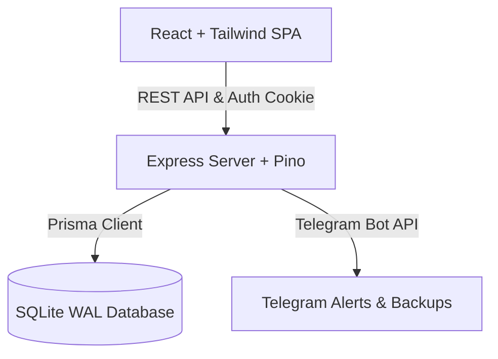

# المعمارية البرمجية لنظام TaskTracker

## القرارات المعمارية الرئيسية
1. **قاعدة البيانات:** استخدام SQLite مع تفعيل نمط WAL لضمان سرعة فائقة في العمل الشخصي وعدم استهلاك أي رامات إضافية على السيرفر.
2. **عزل الحظر الأمني:** يتم التحقق من الـ IP قبل الدخول لأي مسار من مسارات الـ API لردع أي هجمات تخمين.
3. **خدمة الحاوية الموحدة:** السيرفر يقوم بتقديم الـ API وخدمة الواجهة المبنية على بورت واحد لتسهيل النشر على السيرفر.
